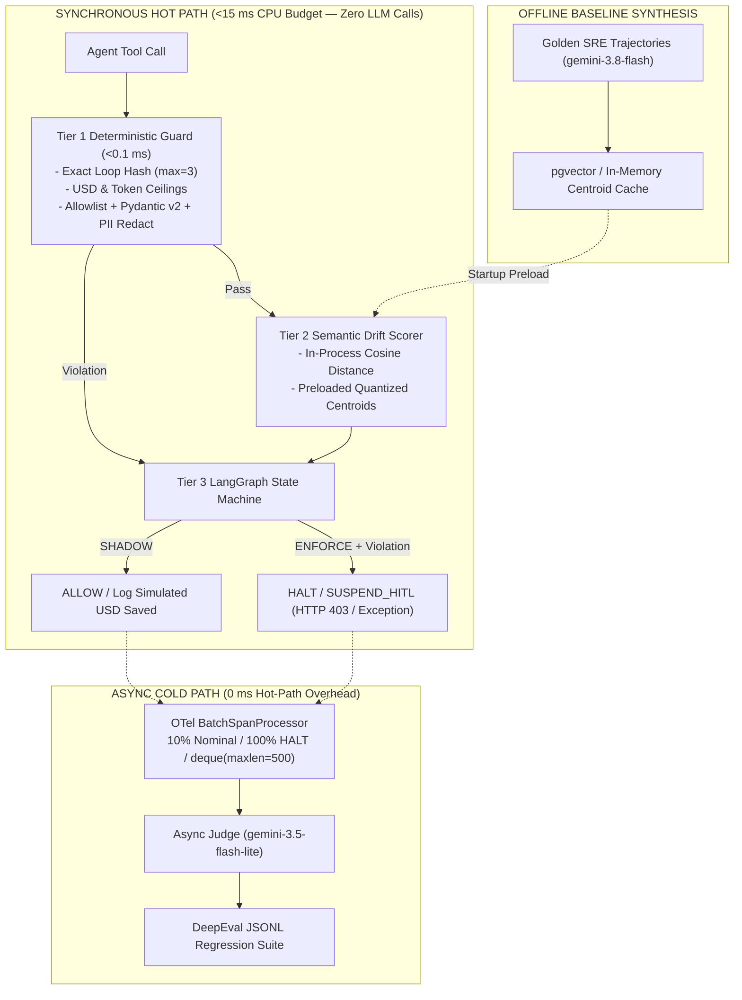

# ⚡ TraceOps AI

> **Deterministic Agent Circuit-Breaker & Runtime Evals Engine**  
> *Apache 2.0 Open-Core Infrastructure for Multi-Agent Systems (LangGraph, AutoGen, MCP)*

[](https://www.python.org/downloads/)
[](https://fastapi.tiangolo.com/)
[](https://langchain-ai.github.io/langgraph/)
[](https://opentelemetry.io/)
[](https://cloud.google.com/run)
[](https://www.apache.org/licenses/LICENSE-2.0)

---

## Core Architectural Invariant

> **"LLMs advise. The deterministic state machine decides."**



---

## 5-Line Quickstart (`SHADOW` -> `ENFORCE`)

```bash
git clone https://github.com/yashh-stack/traceops-ai.git && cd traceops-ai && pip install -e .
```

```python
from traceops import guard, CircuitBreakerError

# Start in SHADOW (zero-risk ROI audit), flip to ENFORCE to halt rogue tool calls mid-flight
@guard(mode="shadow", max_cost_usd=0.50, scenario="incident_triage")
def fetch_pod_logs(pod: str) -> str:
    return f"logs:{pod}"
```

When `mode="enforce"` (or `TRACEOPS_MODE=enforce`), Tier 1/2 breaches raise `CircuitBreakerError` in-process and return `HTTP 403 CIRCUIT_BREAKER_HALT` on the FastAPI proxy (`POST /v1/evaluate-step`).

---

## Verified Benchmarks & Quality Gates

Measured on CPU after security hardening (`tests/test_adversarial_suite.py` & `scripts/run_benchmark.py`, 200 iterations):

| Check / Benchmark | Measured Result | Gate / Baseline |
| :--- | :--- | :--- |
| **Tier 1 Exact Loop Interception** | `0.0883 ms` | `< 1.0 ms` |
| **Hot-Path p50 / p95 / p99** | `4.40 ms` / `9.96 ms` / `14.83 ms` | p95 `< 15.0 ms` (`15.26x` faster vs `152 ms` GPU SLM) |
| **Adversarial Suite (`pytest -v`)** | `16/16` passed (`0` warnings) | `100%` pass |
| **Static Analysis & Security** | `ruff`: `0` · `pyright`: `0` · `bandit`: `0` High/Med · `pip-audit`: `0` CVEs | Clean zero-error gate |

---

## End-to-End Automated CI/CD (GitHub Actions -> Google Cloud Run)

Every push to `main` runs the automated pipeline in [`.github/workflows/deploy-cloud-run.yml`](.github/workflows/deploy-cloud-run.yml):

1. **`verify` job:** Runs `ruff`, `mypy`, `bandit`, `pip-audit`, `pytest -v`, and enforces the `p95 < 15.0 ms` latency regression gate.
2. **`deploy-cloud-run` job:** Authenticates via keyless **Google Workload Identity Federation (OIDC)** (or `GCP_SA_KEY`), builds the hardened non-root `python:3.12-slim` container via Cloud Build, deploys a `--no-traffic` **canary** revision (`TRACEOPS_ENV=production`), smoke-tests `/_stcore/health`, and promotes `100%` traffic only on HTTP `200`.

### One-Shot Cloud Run Connection Bootstrap

Run once locally to link your Google Cloud project (`builder-cup-511710`) to GitHub Actions secrets with zero long-lived JSON keys:

```powershell
# Windows PowerShell
.\scripts\setup_gcp_github_cd.ps1
```

```bash
# Linux / macOS / WSL
./scripts/setup_gcp_github_cd.sh
```

Or trigger an immediate manual canary deploy locally:

```powershell
.\deploy_cloud_run.ps1   # or ./deploy_cloud_run.sh
```

---

## Live Control Room (Streamlit)

Run the Streamlit HUD + background proxy locally:

```bash
streamlit run dashboard/app.py
```

---

## Production Security & Privacy Disclosure

- **Tier 1 Secret & PII Scrubbing:** API keys (`AIza...`, `sk-...`, `ghp_...`), Bearer tokens, DB credential URIs, emails, and sensitive dictionary keys (`password`, `token`, `secret`, `api_key`) are redacted in [`traceops/security.py`](traceops/security.py) *before* OTLP export, logs, or API responses.
- **Fail-Closed Admin Auth:** `/v1/mode`, `/v1/reset`, and `/v1/spans` enforce constant-time `X-TraceOps-Admin-Key` verification via `hmac.compare_digest`. When `TRACEOPS_ENV=production` and `TRACEOPS_ADMIN_TOKEN` is unset, admin endpoints fail closed (`HTTP 503`).
- **Bounded State & Payload Limits:** Per-`trace_id` breaker states use a bounded LRU+TTL cache (`maxsize=10000`, `ttl=1800s`), requests are capped at `64 KB` (`413`), and sliding-window per-IP rate limiting prevents abuse.
- **Disclosure:** Report security vulnerabilities privately via GitHub Security Advisories (`yashh-stack/traceops-ai`). Licensed under **Apache 2.0**.
