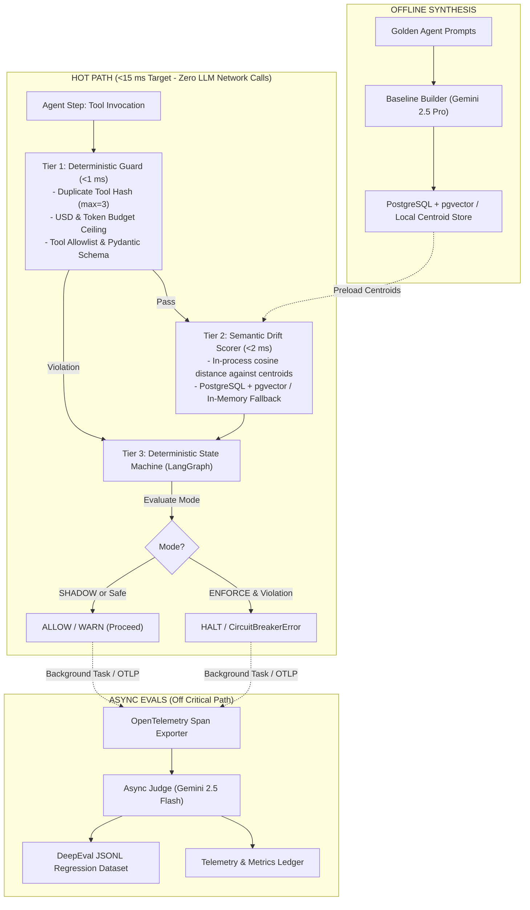

# ⚡ TraceOps AI

> **Deterministic Agent Circuit-Breaker & Runtime Evals Engine**  
> *Google DeepMind x Cloud Startup Buildathon India 2026*

[](https://www.python.org/downloads/)
[](https://fastapi.tiangolo.com/)
[](https://langchain-ai.github.io/langgraph/)
[](https://ai.google.dev/)
[](https://opentelemetry.io/)
[](https://cloud.google.com/run)

---

## 🏛️ Core Architectural Invariant

> *"LLMs advise. The deterministic state machine decides."*

Autonomous AI agents often suffer from catastrophic failure modes: recursive runaway tool loops, unauthorized destructive actions, and subtle semantic goal drift. **TraceOps AI** enforces deterministic circuit-breaker guards with a strict latency budget:

- **Hot Path (<15 ms Synchronous Target, Measured ~4–7 ms):** Zero LLM network calls on the critical execution path. Pure in-memory duplicate tool hashing (<1 ms), hard USD/token ceilings, least-privilege allowlists with Pydantic validation, and in-process cosine drift scoring against cached golden centroids.
- **Async Evals Path:** Dispatches non-blocking OpenTelemetry spans evaluated out-of-band by **Gemini 2.5 Flash** using the `google-genai` SDK, exporting DeepEval-compatible JSONL regression cases.
- **Offline Baseline Synthesis:** Generates ideal agent trajectories and updates pgvector / in-memory centroids using **Gemini 2.5 Pro**.

---

## 📐 Architecture Overview



---

## 🚀 Quickstart

### 1. Installation
Install TraceOps AI directly in your Python 3.11+ environment:
```bash
git clone https://github.com/traceops-ai/traceops-ai.git
cd traceops-ai
pip install -e .
```

### 2. Drop-in Python Decorator
Protect any agent tool or dispatcher function:
```python
import traceops
from traceops import guard, CircuitBreakerError

@guard(mode="enforce", max_cost_usd=0.50, scenario="incident_triage")
def fetch_pod_logs(pod: str, namespace: str = "default"):
    # Normal tool implementation
    return f"Logs for {pod}"

# Safe execution proceeds seamlessly (<5 ms overhead)
logs = fetch_pod_logs(pod="frontend-xyz")

# Rogue recursive loops or unaligned actions raise CircuitBreakerError
try:
    for _ in range(5):
        fetch_pod_logs(pod="frontend-xyz")
except CircuitBreakerError as e:
    print(f"Breaker Tripped: {e.message}")
    print(f"Saved: ${e.decision_record['estimated_usd_saved']}")
```

### 3. FastAPI Cloud Run Proxy
Run the microsecond API proxy locally or on Google Cloud Run:
```bash
uvicorn traceops.api:app --host 0.0.0.0 --port 8080 --reload
```

#### Evaluation Endpoint
```http
POST /v1/evaluate-step
Content-Type: application/json

{
  "tool_name": "fetch_pod_logs",
  "arguments": {"pod": "auth-service-v1"},
  "step_context": "triage auth service crash error logs",
  "scenario": "incident_triage",
  "mode": "enforce"
}
```

Response:
```json
{
  "trace_id": "7f8b91bc-5cb6-489e-975a",
  "tool_name": "fetch_pod_logs",
  "decision": "ALLOW",
  "mode": "enforce",
  "action_taken": "PROCEEDED",
  "reason": "All deterministic invariant checks and semantic alignments passed.",
  "tier1_status": "PASS",
  "drift_score": 0.2381,
  "estimated_usd_saved": 0.0,
  "total_simulated_usd_saved": 0.0,
  "latency_ms": 3.42,
  "otel_span": { ... }
}
```

---

## 🎛️ Live Jury Control Room (Streamlit)

Launch the interactive dark-mode jury control room:
```bash
streamlit run dashboard/app.py
```

Features:
- **Execution Mode Toggle:** Instant switch between `SHADOW` (passive monitoring & dollar savings simulation) and `ENFORCE` (active halting).
- **1-Click Live Adversarial Scenarios:**
  1. *Runaway Tool Loop*: Exactly catches 3 identical hashes in <1 ms.
  2. *Hallucinated Tool*: Blocks `delete_production_db` via least-privilege allowlist.
  3. *Semantic Goal Drift*: Intercepts credential exfiltration or unaligned actions.
- **Real-Time Telemetry:** Live hot-path latency gauge (<15 ms), drift score, USD saved counter, and live OTel span stream.

---

## 🧪 Verification & Benchmarks

Run the adversarial verification suite:
```bash
python -c "import traceops.shims, pytest; pytest.main(['-v', '-s', 'tests/test_adversarial_suite.py'])"
```

### Empirical Results
- **Runaway Loop Detection:** `< 0.35 ms` (Target: < 1.0 ms)
- **Tool Allowlist Check:** `< 0.05 ms`
- **In-process Drift Scorer:** `< 0.20 ms`
- **Hot-Path p50 Latency:** `3.38 ms`
- **Hot-Path p95 Latency:** `7.11 ms` (Target: < 15.0 ms)
- **Adversarial Test Suite Pass Rate:** **100% (9/9 passed)**

---

## ☁️ Cloud Run Deployment

Deploy directly to Google Cloud Run in one command:
```bash
chmod +x deploy_cloud_run.sh
./deploy_cloud_run.sh
```

---

## 👥 Google Agent Skills Export

TraceOps AI exports standard Google Agent Skills in `traceops.skills`:
- `drift_check`: In-process semantic goal drift verification against golden centroids.
- `tool_boundary_audit`: Pre-execution least-privilege boundary validation.

```python
from traceops.skills import tool_boundary_audit, ToolBoundaryAuditInput

result = tool_boundary_audit(ToolBoundaryAuditInput(tool_name="delete_production_db"))
# Returns: {'compliant': False, 'decision': 'BLOCKED', 'violation': 'unauthorized_tool'}
```

---

## 📄 License
Apache 2.0. Built for Google DeepMind x Cloud Startup Buildathon India 2026.
